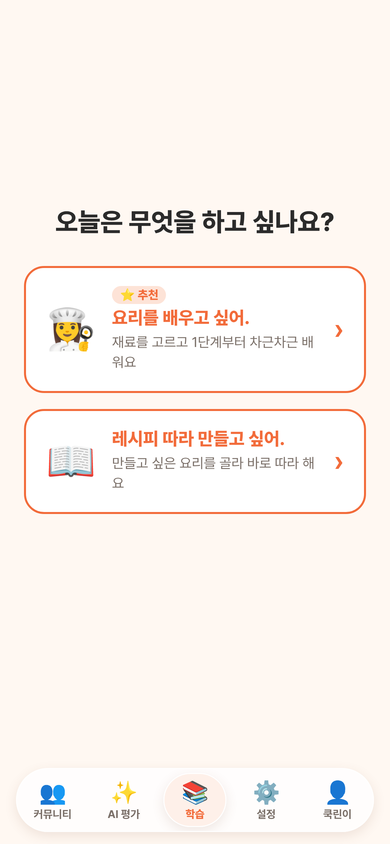
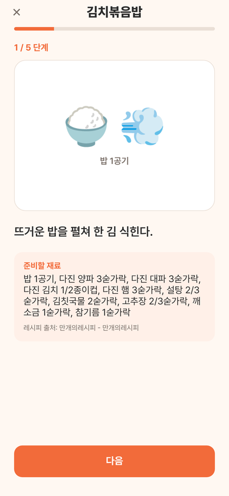
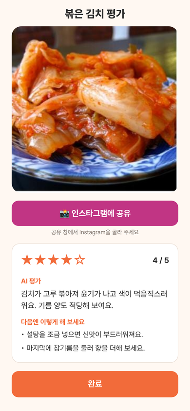
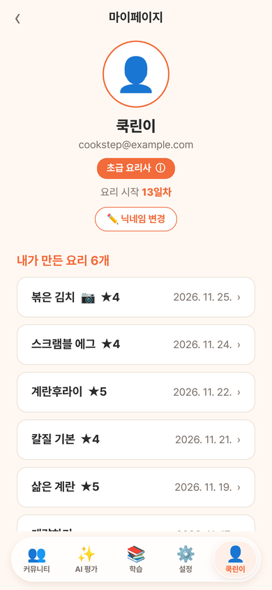
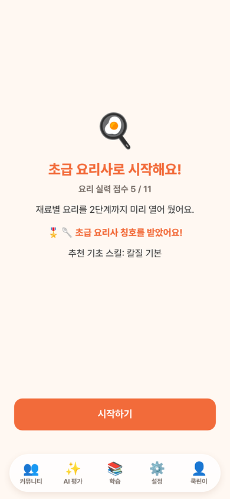
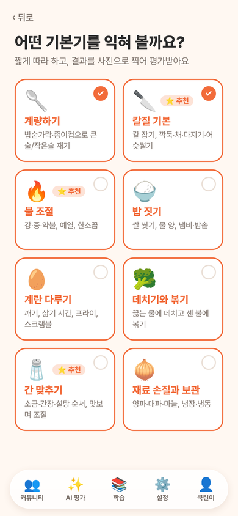
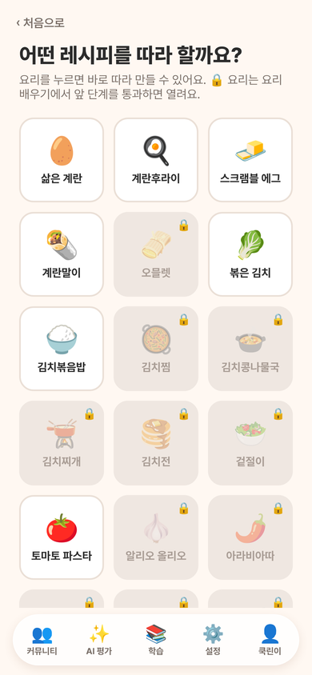
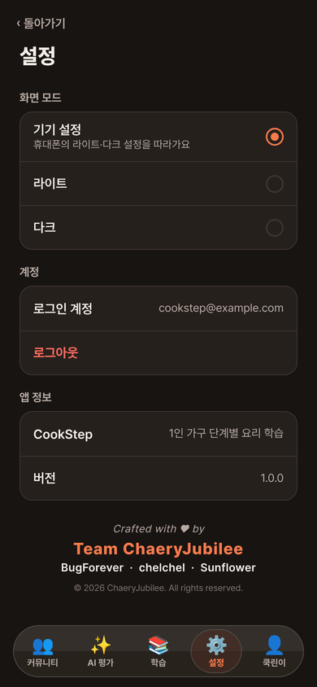
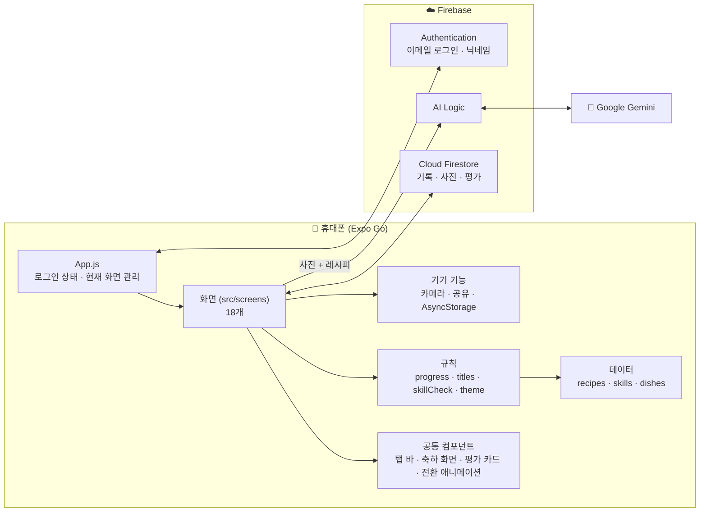
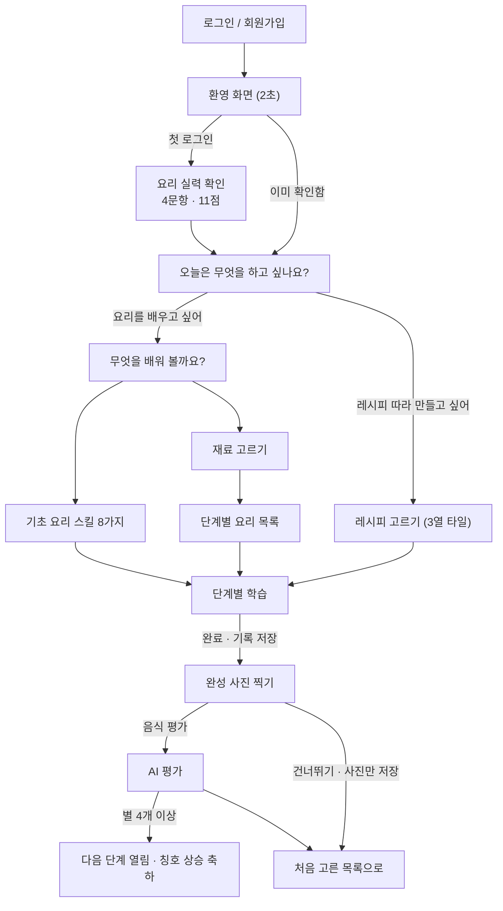

# CookStep 🍳

**혼자 사는 사람을 위한, 한 단계씩 배우는 요리 앱**

CookStep은 요리를 처음 시작하는 1인 가구를 위한 모바일 앱입니다.
처음 로그인할 때 간단한 질문으로 요리 실력을 확인하고, 실력에 맞는 단계에서 시작합니다.
한 화면에 한 단계씩 레시피를 따라 하고, 완성 사진을 찍으면 AI가 별점과 고칠 점을 알려 줍니다.
별 4개 이상을 받으면 다음 단계 요리가 열리고, 요리 기록이 쌓일수록 칭호가 올라갑니다.

(광운대학교 AI 티키타카 프로젝트 출품작)

<p align="center">
  
  
  
  
</p>

> Team **ChaeryJubilee** · BugForever · chelchel · Sunflower · v1.0.0

---

## 목차

- [주요 기능](#주요-기능)
- [화면 미리보기](#화면-미리보기)
- [사용법](#사용법)
- [기술 스택](#기술-스택)
- [시스템 구조](#시스템-구조)
- [폴더 구조](#폴더-구조)
- [업데이트 내역](#업데이트-내역)
- [출처](#출처)

---

## 주요 기능

### 1. 첫 로그인 요리 실력 확인
처음 로그인하면 4가지 질문(요리 빈도, 혼자 만들 수 있는 요리, 칼질, 불 조절·간 맞추기)에 답합니다. 11점 만점으로 수준을 나누고, 결과에 따라 시작 단계와 추천이 달라집니다.

| 점수 | 수준 | 시작 | 추천 |
|---|---|---|---|
| 0~3점 | 🌱 입문 요리사 | 모든 재료 1단계부터 | 기초 요리 스킬, ‘요리 배우기’ |
| 4~7점 | 🍳 초급 요리사 | 2단계까지 미리 열기 | 초급 요리사 칭호 |
| 8~11점 | 👨‍🍳 중급 요리사 | 3단계까지 미리 열기 | 중급 요리사 칭호, ‘레시피 따라 만들기’ |

칼질이 서툴면 ‘칼질 기본’, 불 조절이 어려우면 ‘불 조절’·‘간 맞추기’ 스킬에 ⭐추천 표시가 붙습니다.

### 2. “오늘은 무엇을 하고 싶나요?”
- **요리를 배우고 싶어** → 기초 요리 스킬 또는 재료별 요리 중에서 고릅니다.
- **레시피 따라 만들고 싶어** → 모든 요리를 3열 그림 타일로 보고 바로 골라 따라 합니다. 아직 잠긴 단계의 요리는 🔒로 표시됩니다.

### 3. 기초 요리 스킬 8가지
계량하기 · 칼질 기본 · 불 조절 · 밥 짓기 · 계란 다루기 · 데치기와 볶기 · 간 맞추기 · 재료 손질과 보관.
잠금 없이 모두 열려 있고, 연습한 결과물(예: 썰어 놓은 재료)을 사진으로 찍어 평가받을 수 있습니다. 한 번이라도 완료한 스킬에는 ✓ 표시가 붙습니다.

### 4. 재료별 단계 학습
| 재료 | 단계 |
|---|---|
| 🥚 계란 (5단계) | 삶은 계란 → 계란후라이 → 스크램블 에그 → 계란말이 → 오믈렛 |
| 🥬 김치 (7단계) | 볶은 김치 → 김치볶음밥 → 김치찜 → 김치콩나물국 → 김치찌개 → 김치전 → 겉절이 |
| 🍝 파스타 (7단계) | 토마토 파스타 → 알리오 올리오 → 아라비아따 → 까르보나라 → 뇨끼 → 수제 생면 → 명란 오일 파스타 |
| 🐟 참치 | 업데이트 예정 |

앞 단계 요리에서 AI 평가 **별 4개 이상**을 받으면 다음 단계가 열리고 축하 화면이 나옵니다.

### 5. 한 화면에 한 단계씩 따라 하기
진행 막대, 그림과 설명, 준비 재료, 요리 팁, 레시피 출처를 보여 줍니다. ‘다음’과 ‘이전’으로 넘기고, 마지막 단계에서 완료하면 요리 기록이 저장됩니다.

### 6. 완성 사진과 AI 평가
- 기기 카메라로 완성 사진을 찍으면 정사각형으로 잘라 기록과 함께 저장합니다.
- Firebase AI Logic을 통해 **Gemini**가 사진과 레시피를 함께 보고 **별점(1~5)**, 한 줄 평, 다음에 고칠 점을 알려 줍니다.
- AI가 응답하지 못하면 레시피 팁을 바탕으로 한 기본 평가를 대신 보여 줍니다.
- 완성 사진은 인스타그램 등으로 바로 공유할 수 있습니다.

### 7. 칭호와 마이페이지
| 칭호 | 조건 |
|---|---|
| 🏠 평범한 자취생 | 처음 시작 |
| 🍳 요리 초보 | 요리 1개 완성 |
| 🥄 초급 요리사 | 한 재료라도 3단계 열기 또는 실력 확인 4~7점 |
| 🔪 중급 요리사 | 한 재료라도 5단계 열기 또는 실력 확인 8~11점 |
| 👑 자취 요리 마스터 | 요리가 있는 모든 재료의 5단계 열기 |

마이페이지에서는 프로필, 닉네임, 칭호, “요리 시작 N일차”, 내가 만든 요리 기록(사진과 평가 상세)을 볼 수 있고 닉네임을 바꿀 수 있습니다.

### 8. 하단 탭과 화면
- **리퀴드 글래스 탭 바**: 커뮤니티 · AI 평가 · 학습 · 설정 · 마이페이지(닉네임). 바 위를 손가락으로 밀면 유리 렌즈가 따라오고, 손을 떼면 가장 가까운 탭이 열립니다. iOS 26 이상에서는 실제 Liquid Glass, 그 외 기기에서는 블러로 보입니다.
- **AI 평가 탭**: 지금까지 받은 평가를 모아 보고(평가 수, 평균 별점), 레시피 없이 아무 요리나 찍어 평가받을 수 있습니다. 이 평가는 단계와 칭호에 영향을 주지 않습니다.
- **커뮤니티 탭**: 준비 중입니다.
- **설정**: 화면 모드(기기 설정 · 라이트 · 다크), 로그아웃, 앱 정보.
- **다크 모드**와 **화면 전환 애니메이션**(페이드 + 슬라이드)을 지원합니다.

---

## 화면 미리보기

| 요리 실력 확인 결과 | 기초 요리 스킬 | 레시피 고르기 | 설정 (다크 모드) |
|:---:|:---:|:---:|:---:|
|  |  |  |  |

> 미리보기의 닉네임, 요리 기록, 별점은 예시 데이터입니다.

---

## 사용법

### 준비물
- [Node.js](https://nodejs.org) LTS
- 휴대폰에 **Expo Go** 앱 ([App Store](https://apps.apple.com/app/expo-go/id982107779) / [Google Play](https://play.google.com/store/apps/details?id=host.exp.exponent))
- Firebase 프로젝트 (무료 Spark 요금제로 충분)

### 1. 설치
```bash
git clone https://github.com/jkfuture1213/CookStep.git
cd CookStep
npm install
```

### 2. Firebase 설정
자세한 순서는 [FIREBASE_SETUP.md](FIREBASE_SETUP.md)에 있습니다. 요약하면 다음과 같습니다.

1. [Firebase 콘솔](https://console.firebase.google.com)에서 프로젝트를 만듭니다.
2. **Authentication**에서 이메일/비밀번호 로그인을 켭니다.
3. **프로젝트 설정 > 내 앱**에서 **웹 앱(`</>`)** 을 등록하고, 나온 설정값을 `src/config/firebaseConfig.js`에 붙여 넣습니다.
4. **Firestore Database**를 만들고, 로그인한 사용자가 자기 데이터만 읽고 쓸 수 있게 규칙을 정합니다.
   ```
   rules_version = '2';
   service cloud.firestore {
     match /databases/{database}/documents {
       match /users/{userId}/{document=**} {
         allow read, write: if request.auth != null && request.auth.uid == userId;
       }
     }
   }
   ```
5. **AI Logic**에서 **Gemini Developer API**를 켭니다. 별도 API 키는 필요 없습니다. 사용할 모델은 `src/config/aiConfig.js`에서 바꿀 수 있습니다.

### 3. 실행
```bash
npx expo start
```
터미널에 나온 QR 코드를 휴대폰으로 스캔하면 Expo Go에서 앱이 열립니다.
- iPhone: 기본 카메라 앱으로 스캔
- Android: Expo Go 앱의 “Scan QR code”로 스캔

휴대폰과 컴퓨터가 같은 Wi‑Fi에 있어야 합니다. 연결되지 않으면 `npx expo start --tunnel`을 사용하세요.

### 4. 앱 둘러보기
1. 회원가입(이메일, 비밀번호, 닉네임) 후 로그인합니다.
2. 처음이라면 4가지 질문에 답해 요리 실력을 확인합니다.
3. “오늘은 무엇을 하고 싶나요?”에서 배우기 또는 레시피 따라 만들기를 고릅니다.
4. 단계별로 따라 하고 완료하면 완성 사진을 찍습니다.
5. **음식 평가**를 눌러 AI 평가를 받고, 별 4개 이상이면 다음 단계가 열립니다.

---

## 기술 스택

| 구분 | 사용 기술 |
|---|---|
| 앱 | React Native 0.88, React 19.3, **Expo SDK 58** (Expo Go로 실행, JavaScript) |
| 로그인 | Firebase Authentication (이메일/비밀번호, AsyncStorage로 로그인 유지) |
| 데이터베이스 | Cloud Firestore (요리 기록, 완성 사진, 평가, 실력 확인 결과) |
| AI 평가 | Firebase AI Logic + Google **Gemini** (사진 + 레시피 → JSON 형식 평가) |
| 카메라·사진 | expo-image-picker, expo-image-manipulator, expo-camera |
| 공유 | expo-sharing, expo-file-system |
| UI | expo-glass-effect(Liquid Glass), expo-blur, React Native Animated, react-native-safe-area-context |
| 설정 저장 | @react-native-async-storage/async-storage (화면 모드) |

화면 이동은 별도 내비게이션 라이브러리 없이 `App.js`가 상태(state)로 현재 화면을 정해 바꿉니다.

---

## 시스템 구조

### 전체 구성



### 화면 흐름



하단 탭 바로 언제든 **커뮤니티 · AI 평가 · 학습 · 설정 · 마이페이지**로 이동할 수 있습니다.

### Firestore 데이터 구조

```
users/{uid}/
├── cookedDishes/{id}       만든 요리 기록 { dishId, dishName, completedAt, hasPhoto, evaluation }
├── cookedPhotos/{id}       완성 사진 (요리 기록과 같은 id, JPEG base64)
├── freeEvaluations/{id}    AI 평가 탭에서 받은 평가 { dishName, evaluation, createdAt, hasPhoto }
├── freePhotos/{id}         그 평가의 사진
└── profile/skillCheck      요리 실력 확인 { answers, score, level, completedAt }
```

`evaluation`은 `{ score, summary, improvements, source }` 형태입니다. `source`는 AI 평가면 `ai`, 기본 평가면 `basic`입니다.

---

## 폴더 구조

```
CookStep/
├── App.js                  화면 전환과 로그인 상태 관리
├── app.json                Expo 설정 (이름, 버전, 카메라 권한 문구 등)
├── FIREBASE_SETUP.md       Firebase 설정 안내
├── CREDITS.md              이미지 · 레시피 출처
├── assets/                 아이콘, 재료 이미지
└── src/
    ├── screens/            화면 (로그인, 실력 확인, 목표, 스킬, 재료, 레시피, 학습, 사진, 평가, 마이페이지, 설정 등)
    ├── components/         탭 바(UserMenu), GlassSurface, 축하 화면, 평가 카드, 화면 전환 애니메이션 등
    ├── data/               recipes.js · skills.js · dishes.js (레시피와 단계 데이터)
    ├── config/             firebaseConfig.js · aiConfig.js
    ├── firebase.js         Firebase 초기화
    ├── cookingHistory.js   기록 · 사진 · 평가 저장과 불러오기
    ├── aiEvaluation.js     Gemini 평가 요청과 기본 평가
    ├── skillCheck.js       실력 확인 질문과 점수 계산
    ├── progress.js         단계 열림 규칙 (별 4개 이상)
    ├── titles.js           칭호 규칙
    ├── nickname.js         닉네임
    ├── sharePhoto.js       사진 공유
    └── theme.js            라이트 · 다크 색과 화면 모드
```

---

## 업데이트 내역

### v1.0.0 · 2026-11-26
**요리 실력 확인, 기초 요리 스킬, 새 하단 탭**
- 첫 로그인 때 4문항 요리 실력 확인 추가 (입문 · 초급 · 중급에 따라 시작 단계 · 칭호 · 추천 결정)
- “오늘은 무엇을 하고 싶나요?” 화면 추가: 요리 배우기 / 레시피 따라 만들기
- 기초 요리 스킬 8가지 학습 추가 (완료한 스킬 ✓ 표시)
- 레시피 따라 만들기 화면 추가 (3열 그림 타일, 잠긴 단계 🔒)
- 리퀴드 글래스 하단 탭 바: 커뮤니티 · AI 평가 · 학습 · 설정 · 마이페이지, 스와이프로 탭 이동
- AI 평가 탭 추가: 받은 평가 모아보기, 레시피 없이 사진만으로 평가받기
- 다크 모드와 설정 화면 추가 (화면 모드, 로그아웃, 앱 정보)
- 화면 전환 애니메이션 추가
- 커뮤니티 탭 추가 (준비 중)
- 완성 사진을 기기 카메라 앱으로 찍도록 변경

### 2026-11-25
**단계 해제, 칭호, 마이페이지 개편**
- 김치 · 파스타 요리 각 7단계 레시피 추가 (레시피 출처 표시)
- 별 4개 이상이면 다음 단계가 열리는 단계 해제 규칙과 축하 화면 추가
- 칭호 5단계와 칭호 상승 축하 화면 추가
- 회원가입 닉네임 추가, 마이페이지에서 닉네임 변경
- 마이페이지 개편: 프로필 · 칭호 · 요리 시작 N일차 · 요리 기록 사진과 평가 상세
- 완성 사진 인스타그램 공유 추가

### 2026-11-24
**AI 음식 평가**
- Firebase AI Logic(Gemini)으로 완성 사진 평가: 별점 · 한 줄 평 · 고칠 점
- AI가 응답하지 못할 때 보여 주는 기본 평가 추가
- 마이페이지에서 평가 결과 보기

### 2026-11-24
**첫 버전**
- Expo(React Native) 앱과 Firebase 이메일 로그인 · 회원가입
- 환영 화면, 재료 선택, 재료별 요리 목록 (계란)
- 한 화면에 한 단계씩 따라 하는 학습 화면과 Firestore 요리 기록 저장
- 완성 사진 찍기와 마이페이지

---

## 출처

- 김치·파스타 레시피는 [만개의레시피](https://www.10000recipe.com) 사용자 레시피를 짧게 정리해 사용했습니다.
- `assets/kimchi.jpg`: Jeremy Keith, “Korean cuisine-Kimchi-08.jpg”, Wikimedia Commons, CC BY 2.0

자세한 내용은 [CREDITS.md](CREDITS.md)를 참고하세요.
